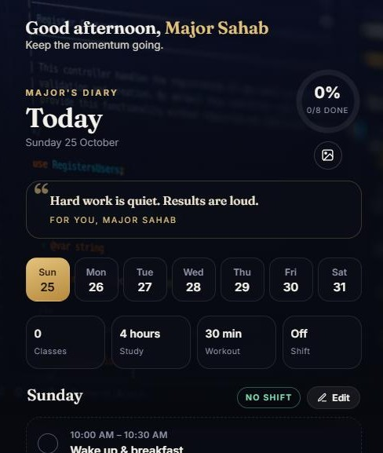

<div align="center">

# Major's Diary

**A personal daily planner with a home-screen widget — classes, study, home workouts and shifts, all in one place.**

[](https://github.com/Zahid-56/Major-s-diary/releases/latest/download/MajorsDiary.apk)
[](https://zahid-56.github.io/Major-s-diary/)



</div>

## Features

- **Full day plan** — wake-up to sleep, built around the BSSE-5D class timetable
- **Tap to check off** — progress ring and daily reset
- **Make it yours** — edit any day, copy between days, or start from a blank routine
- **Home workouts** — bodyweight sessions, no gym needed
- **Beautiful backgrounds** — coding and nature photos that change every 2 minutes, or your own photo
- **Personal greeting & quotes** — "Good morning, Major Sahab"; tap the name to change it
- **Home-screen widgets** — a cute 2×2 *Mini* widget (now · next · progress) and a 4×4 *Full day* checklist
- **Works offline** as an installable web app

## Install on Android

1. Download **[MajorsDiary.apk](https://github.com/Zahid-56/Major-s-diary/releases/latest/download/MajorsDiary.apk)** and open it (allow installs from your browser if asked).
2. Long-press your home screen → **Widgets** → **Major's Diary · Mini** or **Full day**.
3. Open the app and tap **Edit** to build your own routine — the widgets update automatically.

## Project structure

```
docs/          Web app (served by GitHub Pages)
android/       Android app and widgets (Java)
.github/       Workflow that builds the APK and publishes a release
```

## Development

- **Web:** plain HTML, CSS and JavaScript in `docs/index.html` — no build step.
- **Android:** `cd android && gradle assembleDebug` (JDK 17, Android SDK 34).
- Every push to `android/` builds a new APK and publishes it under **Releases**.

<sub>Background photos from [Unsplash](https://unsplash.com).</sub>
